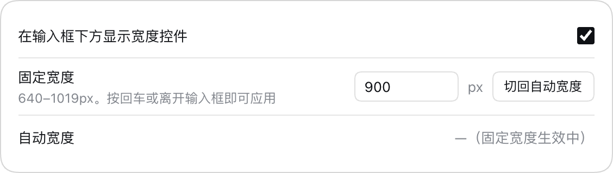
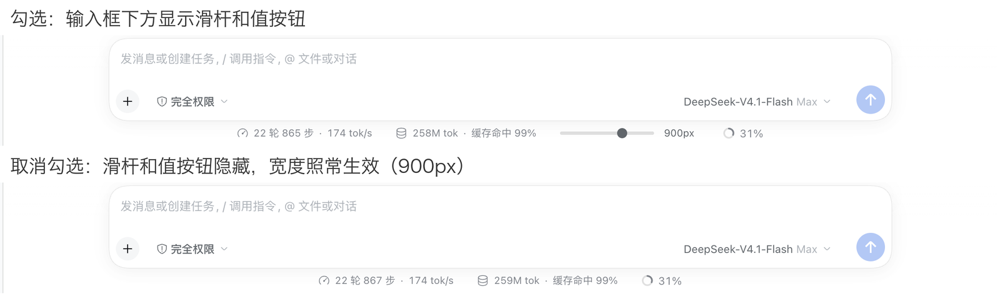

#  dsh-widthkeeper

GitHub：<https://github.com/YuLaiZ/dsh-widthkeeper>

**守宽人**是 DeepSeek Harness 的会话宽度插件，支持 Web 版和桌面版。用滑杆或像素值设置主会话的正文宽度，设好后可以隐藏控件。

## 解决的问题

- **手柄不容易找到。** 正文两侧的拖拽手柄平时隐藏，鼠标移到边缘才会出现。可拖动的区域较窄，容易错过。
- **默认宽度随布局变化。** 缩放窗口或打开侧栏时，正文宽度会随可用空间变化。想保持习惯的阅读宽度，有时需要重新调整。
- **拖动时没有像素读数。** 想设成某个具体宽度，例如 900px，只能凭视觉估计。
- **调宽依赖鼠标拖动。** 原生设置页没有宽度输入项，也没有可用键盘操作的调宽入口。

守宽人在输入框下方提供滑杆和数值按钮。你也可以在设置页输入像素值，再把会话里的控件隐藏起来。插件会保留设定，并在空间足够时应用该宽度。

## 功能

- 拖动滑杆固定宽度，或点击数值按钮输入精确的像素值。
- 可设范围随窗口和会话布局调整。滑杆最右端对应当前可设上限。
- 使用自动宽度时，滑杆跟随原生手柄，悬停在「自动」按钮上可查看读数。
- 在设置页的「内容宽度」里输入固定宽度、显示或隐藏控件，或恢复默认设置。

插件只管理主会话正文宽度。右侧栏的子会话继续使用 Harness 自带的布局。

插件文案支持中文和英文。Harness 界面使用中文时显示中文，其余情况显示英文。

## 安装

DSH 插件页「添加插件」，可从 GitHub 或 npm 安装：

- GitHub：`github:YuLaiZ/dsh-widthkeeper`
- npm：`@yulaiz/dsh-widthkeeper`

Web 版与桌面版各自独立安装，profile 互不相通：

| 客户端 | profile | 安装方式 |
|---|---|---|
| Web（`dsh web`） | `~/.dsh/profiles/web` | 在插件页选择「添加插件」，安装后点「立即启用」（Enable now） |
| 桌面版（App） | `~/.dsh/profiles/desktop` | 在插件页选择「添加插件」，安装后点「立即启用」（Enable now），按界面提示重启 |

> 如果已经安装其他宽度控制类插件，请先禁用它或从 profile 卸载，再安装本插件——同时启用会争抢同一条宽度轴，互相覆盖宽度和手柄状态。

## 使用

- **滑杆** — 拖动即固定宽度，通常每格 10px。最右端对应当前可设上限，例如上限为 1014px 时，拖到底可以设为 1014px。固定后正文两侧的原生手柄会隐藏。
- **固定宽度** — 点击数值按钮展开输入框。按 `Enter` 或离开编辑区域提交。按 `Esc` 或点击「取消」可放弃输入。超出范围时取最近的边界值，留空或输入无效值时保留原值。也可以在展开的控件中切回自动宽度。
- **超出当前上限** — 已保存的宽度超过当前可设上限时，数值按钮会显示上限。正文宽度仍受可用空间限制，窗口尺寸变化会保留原有设置。在设置页或展开的输入框中可以查看保存值。
- **自动宽度** — 悬停在「自动」上可以查看宽度及其来源，例如 `自动 · 836px（拖手柄调整过）`。点击「自动」会尝试固定当前读数，超出可设范围时取最近的边界值，读不到时沿用上次保存的值。
- **窄窗口** — 可设范围只剩一个值时，滑杆变灰并停在最左，宽度输入框也会禁用。拉宽窗口后即可继续调整。

### 设置页

在设置页左侧选择「内容宽度」。

- **在输入框下方显示宽度控件** — 取消勾选即可隐藏滑杆和数值按钮，已设置的宽度仍会生效。重新勾选即可恢复显示。

  

- **固定宽度** — 输入像素值后按 `Enter` 或离开输入框即可应用。自动宽度下，输入框显示已保存的值，点击「切回固定宽度」即可应用。无法测量当前会话时，输入范围为 640–2000px。
- **自动宽度** — 显示自动宽度的读数和来源。固定宽度生效或暂时无法读取时，会显示状态说明。
- **恢复默认** — 恢复插件默认的固定宽度并显示控件。Harness 的原生手柄设置会保留。

## 工作原理

固定宽度时，插件将保存的值应用到 Harness 的正文宽度变量。切回自动宽度后，正文宽度由 Harness 决定。可设范围参考原生手柄，并随窗口、分栏和滚动区尺寸变化重新计算。

具体的计算和测量方式见 [源码注释](src/client.js)。

## 兼容性

- 最低要求为 DeepSeek Harness `0.2.0-rc.1`，支持 Web 版和桌面版。具体兼容范围以插件包的 `engines.dsh` 为准。
- 插件依赖 Harness 的正文结构和宽度设置。宿主界面改版可能影响调宽或自动读数。
- 支持宿主的 Tooltip 组件。缺少该组件时，宽度控件仍可使用。

## 开发

克隆后用插件页「添加插件」填 `link:/你的克隆目录`（软链安装，改的是克隆目录里的源码），即可直接在仓库里改：

- 只改 `src/client.js`：Web 版刷新页面生效；桌面版（Electron）没有可用的应用内刷新入口，需完全退出并重开 DSH。
- 改 `package.json` / `cordis.patch.yml` 或重新安装 bundle：Web 版重新执行 `dsh web`；桌面版退出并重开。
- 桌面版与 Web 版可以同时 `link:` 同一个克隆目录，改一份代码；两端按上面的方式各自重新加载（Web 刷新、桌面重开）。
- 文案在 `src/client.js` 的 `DICTS`（zh / en 两套，键名必须一致）；新增语种只需加一份字典并注册，未注册的语言回落到英文。
- 悬浮说明用 `@deepseek-ai/dsh-client-ui-primitives` 的 `Tooltip`（与上下文徽标同组件），不再使用原生 `title`。

不要用 `file:` 前缀：pnpm 会把目录收进 `.pnpm` 虚拟 store 作为副本，改源码不会传到 `node_modules`，热改失效。

## 变更记录

各版本的变更与升级影响见 [CHANGELOG](https://github.com/YuLaiZ/dsh-widthkeeper/blob/main/CHANGELOG.md)。

## 来源与致谢

本仓库的代码基线来自 [Jinngoo/dsh-conversation-width](https://github.com/Jinngoo/dsh-conversation-width) 0.1.3（MIT，作者 jinngoo）。在此基础上重命名、扩展功能并独立维护；原作者版权声明保留在 [LICENSE](./LICENSE)。

## 许可证

MIT，见 [LICENSE](./LICENSE)。
